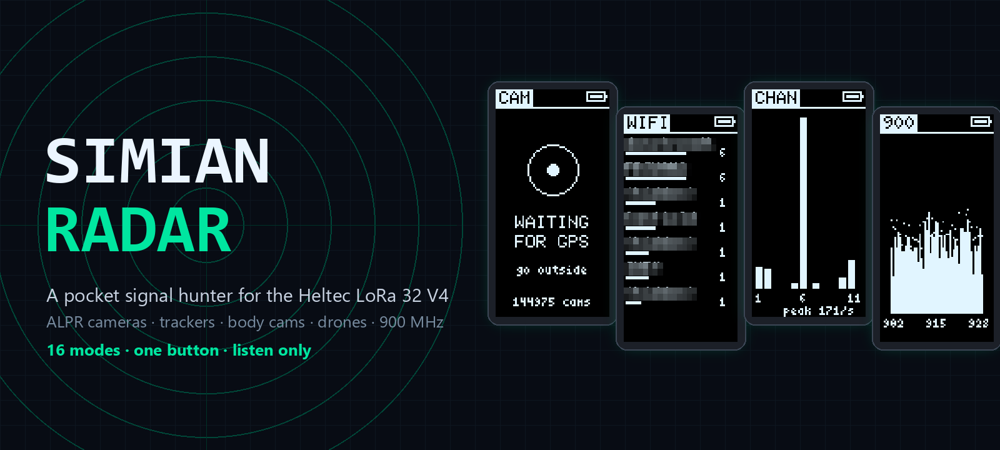
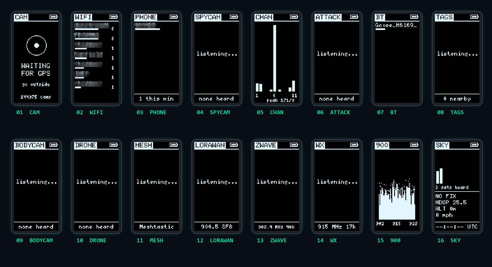
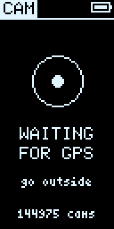
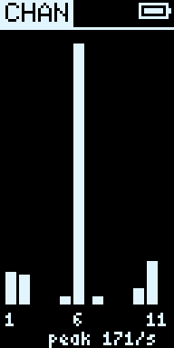
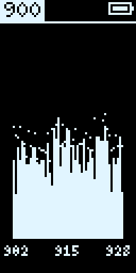
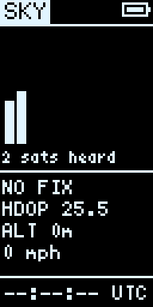
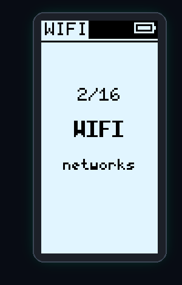

<div align="center">



# Simian Radar

**A listen-only pocket privacy scanner. Plug it into your car, tap one button, and see who and what is watching.**


</div>

---

## What is it?

Simian Radar turns a **Heltec WiFi LoRa 32 V4** (with the L76K GPS fitted) into a pocket or dashboard
gadget that listens to every radio it has and tells you what is around you:

- 📷 **License plate cameras ahead.** The whole US map of ALPR cameras (Flock, Motorola/Vigilant,
  Genetec and friends, about **145,000** of them) lives offline in the board's flash. Drive toward one and
  you get a **CAMERA AHEAD** alert at 1,000 ft with an arrow relative to your direction of travel.
- 🏷️ **Trackers following you.** An AirTag, Tile, SmartTag or Google Find My tag that is not yours and
  stays with you for 10+ minutes over half a mile triggers **TRACKER FOLLOWS YOU**.
- 🕶️ **Smart glasses nearby.** Meta and Snap camera glasses pop a toast the moment they show up.
- 👮 **Body cams, drones, attacks and more.** Axon body cams, FAA Remote ID drones, deauth floods,
  evil twins, Pwnagotchis, Flipper Zeros, BLE popup spam, mesh radios, LoRaWAN, Z-Wave, weather stations,
  a 900 MHz spectrum sweep and a GPS jamming/spoofing guard.

It is **listen only**. It never transmits, never joins a network, never decrypts anything and never
captures payloads. It reads the headers and public broadcasts that devices already shout into the air.

> Pitched as **personal privacy and anti-stalking** gear. Cameras that catch real crime are fine; the
> point is knowing when you are being logged or followed.

---

## The 16 modes

One mode on screen at a time. **Tap** the button for the next one. That is the whole interface.

<div align="center">

<br><sub>Real framebuffer captures pulled off the board over USB (nearby network names pixelated).</sub>
</div>

| # | Mode | Radio | What you see |
|---|------|-------|--------------|
| 01 | **CAM** | GPS + DB | The nearest 4 ALPR cameras, distance and arrow, brand. Alert at 1,000 ft. |
| 02 | **WIFI** | 2.4 GHz | Access points by signal. Flock camera signatures float to the top. |
| 03 | **PHONE** | 2.4 GHz | Phones and laptops sending WiFi probe requests, by maker or "random". |
| 04 | **SPYCAM** | 2.4 GHz | WiFi cameras: Ring, Blink, Wyze, Arlo, Eufy, Hikvision, Dahua, Reolink, Nest, Tuya... |
| 05 | **CHAN** | 2.4 GHz | Frames per second on channels 1 to 11 as a live bar graph. |
| 06 | **ATTACK** | 2.4 GHz | Deauth floods, evil twins, karma/Pineapple, Pwnagotchi, Flipper, BLE popup spam. |
| 07 | **BT** | 2.4 GHz | Every BLE device in range. |
| 08 | **TAGS** | 2.4 GHz | Trackers and smart glasses only, with how long they have been with you. |
| 09 | **BODYCAM** | 2.4 GHz | Axon body cams, Tasers and in-car units (IEEE OUI `00:25:DF`). |
| 10 | **DRONE** | 2.4 GHz | ASTM F3411 Remote ID: serial, altitude, distance and arrow to drone and pilot. |
| 11 | **MESH** | 900 MHz | Meshtastic and MeshCore nodes heard, RSSI and SNR. |
| 12 | **LORAWAN** | 900 MHz | US915 uplinks, DevAddr mapped to Helium / The Things Network. |
| 13 | **ZWAVE** | 900 MHz | Z-Wave networks (HomeID) and node counts. |
| 14 | **WX** | 900 MHz | 915 MHz weather stations (Fine Offset / Ambient / Ecowitt). |
| 15 | **900** | 900 MHz | 902 to 928 MHz RSSI sweep with peak hold, RFID/toll reader flag. |
| 16 | **SKY** | GPS | Satellites, fix, HDOP, altitude, speed, UTC, jamming/spoofing guard. |

**Background alerts run in every mode:** CAMERA AHEAD, TRACKER FOLLOWS YOU, glasses toast, attack toasts
and GPS JAMMING? / SPOOFING?

<table>
<tr>
<td align="center"><br><b>CAM</b><br><sub>offline ALPR map</sub></td>
<td align="center"><br><b>CHAN</b><br><sub>2.4 GHz traffic</sub></td>
<td align="center"><br><b>900</b><br><sub>sub-GHz sweep</sub></td>
<td align="center"><br><b>SKY</b><br><sub>GPS health</sub></td>
<td align="center"><br><b>Mode banner</b><br><sub>shown on every tap</sub></td>
</tr>
</table>

---

## Hardware

| Part | Notes |
|------|-------|
| **Heltec WiFi LoRa 32 V4** | ESP32-S3, 16 MB flash, SX1262 LoRa radio, 0.96" SSD1306 OLED (run in portrait). |
| **L76K GPS module** | Plugs into the V4's GPS header. Needed for CAM, SKY, marks and the follow detector. |
| **915 MHz antenna** | For the 900 MHz modes (US band). |
| **USB-C power** | Designed as a car device on USB power. Battery works too. |
| A case | Rev's lives in a 3D printed walkie-talkie style shell. |

Pin facts that bit us (all handled in the firmware): **Vext on GPIO36 is active LOW** on the V4
(LOW = OLED and GPS powered), the GPS UART is **RX 39 / TX 38** from the ESP's side, button on GPIO0,
LED on GPIO35, OLED I2C SDA 17 / SCL 18 / RST 21.

**Not possible on this board** (so not attempted): Zigbee/Thread, 5 GHz WiFi, 315/433 MHz devices,
utility meters, cellular.

---

## How to use it

### The button

| Action | Result |
|--------|--------|
| **Tap** | Next mode. A full-screen banner (`3/16 PHONES`) shows where you are. |
| **Hold 5 seconds** | **Mark a camera** at your current GPS position. Works in any mode, needs a fix. Marks are saved to flash. |

### On the road

1. Plug the board into USB in the car and let the GPS get a fix (go outside the first time; CAM shows
   `WAITING FOR GPS` until it locks).
2. Leave it on **CAM**. The four closest cameras are listed with distance and an arrow relative to the
   way you are moving (there is no compass, so the arrow needs you to be moving).
3. When a camera comes within 1,000 ft you get **CAMERA AHEAD** no matter which mode is on screen.
4. Spot a camera that is not on the map? **Hold the button 5 s** to mark it.
5. Tap through the other modes whenever you are curious what else is in the air.

### Reading the screens

- Lists are sorted strongest or closest first. The bar under each name is signal strength.
- The footer is a summary: a count, a frequency, a peak rate or `none heard`.
- The 900 MHz modes (MESH, LORAWAN, ZWAVE, WX, 900) only run the SX1262 while they are on screen. Their
  lists start fresh each time you enter them, and the radio goes to standby when you leave.

---

## Build and flash

You need [PlatformIO](https://platformio.org/) and Python 3.

### 1. Flash the firmware

```bash
git clone https://github.com/revjmoney/simian-radar.git
cd simian-radar
pio run -e heltec_v4 -t upload
```

The upload port defaults to `COM11` in [`platformio.ini`](platformio.ini); change `upload_port` and
`monitor_port` for your machine. Uploads use esptool 4.9 with a watchdog reset, because older esptool
cannot reset this board over native USB.

### 2. Build and flash the camera database

The camera map comes from **OpenStreetMap**, via the daily tiles that [DeFlock](https://deflock.me)
publishes. The tool downloads every US region, packs it into a compact grid-indexed binary and writes it
to a dedicated ~9 MB `camdb` partition (room for ~750k cameras).

```bash
pip install -r tools/camdb/requirements.txt
python -I tools/camdb/build_camdb.py --out build/camdb.bin
```

```powershell
tools/flash_camdb.ps1 build/camdb.bin -Port COM11
```

Rebuild and reflash whenever you want fresher camera data. The firmware does not need to be rebuilt.

### 3. Run the host tests

188 unit tests cover the parsers, decoders, detectors, geo math, the camera DB and the mark store.

```bash
pio test -e native
```

(On Windows, [`tools/native_test.sh`](tools/native_test.sh) puts an MSYS2 MinGW `g++` on the PATH first.)

### 4. Screenshot the OLED from your PC

No camera needed. Over USB serial the firmware answers `d` with the framebuffer and treats `n` as a
button tap.

```bash
python -I tools/screenshot.py out.png
python -I tools/screenshot_all.py sheet.png COM11 16
```

The second command taps through every mode and builds a contact sheet like the one above.

---

## Project layout

```
src/            main loop, hardware drivers (WiFi sniffer, BLE, GPS, SX1262, LittleFS), OLED screens
lib/            portable, host-tested logic: camdb, geo, follow detector, attack/drone/sky/subghz decoders, OUI makers
test/           Unity tests run on the PC with `pio test -e native`
tools/camdb/    camera database builder (OpenStreetMap / DeFlock tiles to camdb.bin)
tools/oui/      generates maker tables from the IEEE OUI registry
docs/           design docs and build plans
boards/, variants/   Heltec V4 board definition (from MeshCore, MIT)
partitions.csv  16 MB layout with the raw camdb partition at 0x710000
```

---

## Roadmap

- [x] **Phase 1:** standalone firmware. GPS, offline camera DB, 16 modes, alerts, camera marks.
- [ ] Outdoor GPS fix, drive test of CAMERA AHEAD, bench test of marks across a reboot, on-air checks
      of the 900 MHz decoders.
- [ ] **Phase 2:** MeshCore mesh. A private "Simian Radar" channel for chat and camera reports only.
      **Never shares anyone's position**, no periodic adverts, rotating BLE address.
- [ ] **Phase 3:** Android app. Chat tab and marks tab; you submit your own marks to OpenStreetMap
      with your own account (OSM rules forbid auto-submitting).

---

## The rules it lives by

- **Listen only.** No transmit calls anywhere in the firmware (grep-verified). No jamming, no joining any
  camera's WiFi, no payload capture, no decryption.
- **No fake data.** Every screen shows only what the radios actually heard.
- **One mode at a time, changed only by the button.**

Check the laws where you live before scanning, and respect other people's privacy with what you see.

---

## Credits and licenses

- Camera data **© OpenStreetMap contributors**, available under the
  [ODbL](https://opendatacommons.org/licenses/odbl/). Tiles served by [DeFlock](https://deflock.me).
- Heltec V4 board definition and pin variant from [MeshCore](https://github.com/meshcore-dev/MeshCore) (MIT).
- Remote ID decoding by [opendroneid-core-c](https://github.com/opendroneid/opendroneid-core-c) (Apache-2.0).
- Maker tables generated from the [IEEE OUI registry](https://standards-oui.ieee.org/).
- Display: Adafruit SSD1306 + GFX, U8g2_for_Adafruit_GFX. GPS: TinyGPSPlus. BLE: NimBLE-Arduino. LoRa: RadioLib.

Details in [THIRD_PARTY.md](THIRD_PARTY.md).

<div align="center">
<br>
<b>Made by Rev. J. Money</b>
</div>
